文章链接：[Zhou_HiVT_Hierarchical_Vector_Transformer_for_Multi-Agent_Motion_Prediction_CVPR_2022](https://openaccess.thecvf.com/content/CVPR2022/papers/Zhou_HiVT_Hierarchical_Vector_Transformer_for_Multi-Agent_Motion_Prediction_CVPR_2022_paper.pdf)
代码链接：[https://github.com/ZikangZhou/HiVT?tab=readme-ov-file](https://github.com/ZikangZhou/HiVT?tab=readme-ov-file)
## 简述
* 难点问题
    * 计算成本高昂： 现有的向量化方法通常在空间和时间维度上通过Transformer进行全对全（all-to-all）的交互建模，随着实体数量增加，计算量急剧上升 
    * 实时性与不变性的矛盾： 现有方法通常对平移和旋转不具备鲁棒性。为了解决这个问题，往往需要以每个目标智能体为中心对场景进行归一化（Re-normalization），这意味着预测N个智能体需要进行N次计算，极其耗时，难以满足实时性要求

* 核心工作
    * 分层策略（Hierarchical Strategy）：将整个预测问题建模，分解为local context信息提取和global交互建模，能够在存在大量agent的场景下也完成高效的预测
    * 平移不变性场景表示（Translation-Invariant Representation）：提出了一种完全基于相对位置的向量化场景表示方法，摒弃了绝对坐标，自然保证了平移不变性
    * 旋转不变性空间学习（Rotation-Invariant Spatial Learning）：设计了旋转不变的交叉注意力模块，使得模型能够在单次前向传播中同时预测场景中所有智能体的轨迹，且对全局坐标系的旋转具有鲁棒性

## 方法
HiVT的核心架构包含两个主要阶段：局部编码器（Local Encoder）和全局交互模块（Global Interaction Module）
局部编码器：对每个agent的局部旋转不变性（rotationinvariant）信息进行编码，包含ego、相邻agent和地图结构之间的丰富信息
全局交互模块：集合不同agent的local context，用于更新每个agent的特征表示并捕捉长期和场景化的动态变化
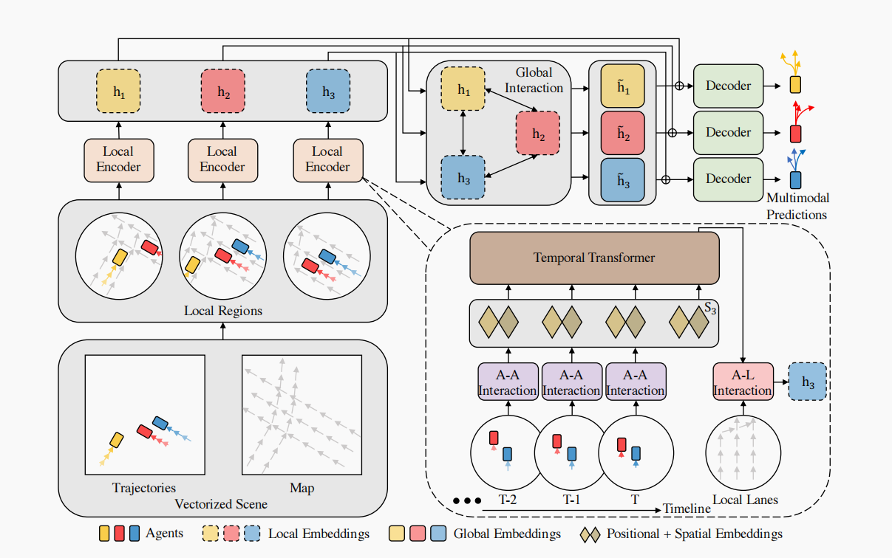
### 场景表示
* 为了保证平移不变性，模型不使用绝对坐标。agent轨迹表示为位移向量 $\{p_i^t - p_i^{t-1}\}$，车道线段表示为起点和终点的相对向量
* 为了保留空间关系，引入了agent之间和agent与车道之间的相对位置向量（如 $p_j^t - p_i^t$）

### 分层矢量化Transformer
#### 核心思想
（1）局部local假设化
如果使用Transformer直接对N个agent的T个历史时刻，以及L个地图元素进行处理，时间复杂度为$O((NT + L)^2)$
HiVT没有进行全局的all-to-all交互，而是分而治之，将计算分解为三个可并行或顺序处理的独立部分：O(NT²)：每个agent自身的时序建模  O(TN²)：每个时间步内的agent间交互  O(NL)：agent-地图元素交互，最终时间复杂度为O(NT² + TN² + NL)
通过引入局部性假设进行进一步优化，O(TNk)：将全局空间交互限制为局部交互，O(Nℓ)：将全局地图交互限制为局部交互，O(NT²)：保持不变，则最终时间复杂度为O(NT² + TNk + Nℓ)
其中ℓ为考虑地图元素的半径，k为每个agent考虑的交互障碍物数量
（2）全局交互表示
对于N个agent的局部local特征，再进行每个agent之间的交互特征表示，弥补local假设带来的感受野不足
#### Local Encoder
（1）agent之间的Interaction
每个agent的xy坐标以轨迹最后两点的矢量方向进行旋转；位置和其他feature特征作为MLP的输入
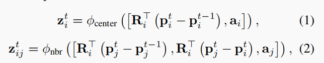
每个local区域，中心agent特征作为query，邻域agent特征作为key和value
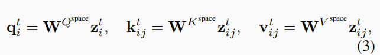
之后是比较常见的点积注意力，不同的是这里在（6、7）加了一个gating function，这个block可以被扩展为multi head attention
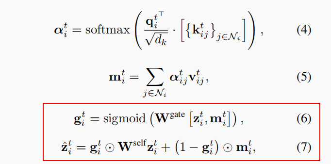
（2）时序上的特征
对于每个agentT个时刻的Interaction feature，在T+1位置新增一个维度相同的token，同时再加上位置编码，作为temporal attention block的输入，做self attention
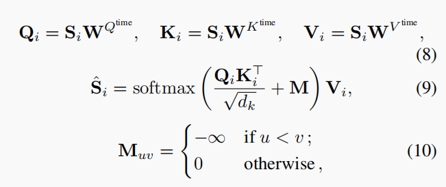
这里的token作用是在学习过程中，将长度可变的时序信息，高效、智能地压缩成一个固定维度的特征向量
其中M为temporal mask，保证当前时刻只考虑之前的时序信息
（3）agent和lane的Interaction
lane的起点和终点矢量被旋转到对应agent的轨迹末端矢量方向，并和lane相关属性作为MLP的输入
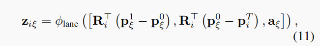
随后（2）过程输出的token feature作为Query，lane相关feature作为Key和Value，作为和（1）过程一样的点积注意力，得到的最终输出$h_i$作为agent i在local区域内的feature
#### Global Interaction Module
由于局部特征是在各自的坐标系中提取的，需要首先对不同agent坐标系进行embedding表示
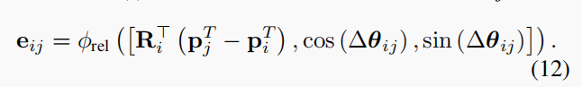
同样的$h_i$作为Query，$h_i$和相对坐标系编码$\varTheta_{ij}$的concat结果作为Key和Value，作为和（1）一样的点积注意力输入，得到最终的输出$\widetilde{h_i}$作为agent i在global Interaction的feature，并用于后续的decoder
#### Multimodal Future Decoder
预测轨迹通常是多模态的，预测输出基于混合拉普拉斯分布（Mixture of Laplace distributions）对未来轨迹进行参数化
agent的local特征输出$h_i$和global特征输出$\widetilde{h_i}$concat后，作为2个MLP的输入，回归得到大小为（F,N,H,4）的轨迹输出和大小为（N,F）的概率输出
其中F为轨迹多模态的数量，N为场景中agent的数量，H为预测的时间step，4为拉普拉斯分布的参数维度
拉普拉斯分布参数之一为$\mu^t_{i,f}\in R^2$，直接表示轨迹在local下的xy坐标；另一参数$b^t_{i,f}\in R^2$表示在x和y上的不确定性
### 训练loss
训练loss使用variety loss，对于F个模态轨迹中选择误差最小的计算loss，loss分为回归误差和分类误差
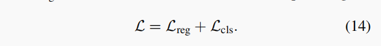
回归误差采用负对数似然计算，函数P为拉普拉斯分布的概率密度函数；分类误差采用交叉熵
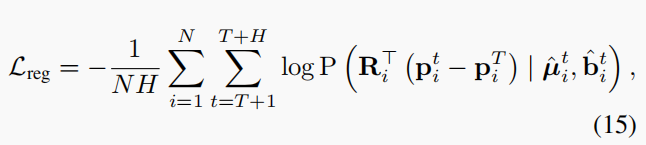
## 实验
数据集：Argoverse motion forecasting
预测补偿：历史2s，预测3s；模态数为6
metric：minADE，minFDE，Miss Rate (MR，预测终点距离GT重点在2.0m范围内)
### Implementation Details
设备：RTX 2080 Ti GPU
优化器：AdamW；学习率衰减cosine annealing scheduler
Attention Head：agent-agent/ agent-lane 1；temporal module 4；global interaction module 3
Local区域假设：50m内
hidden dim：64和128
### Ablation Studies
对不同encoder模块、旋转不变性、hidden_dim进行了消融实验
最终结论和表现看，temporal attention和旋转不变形对预测结果提升较大
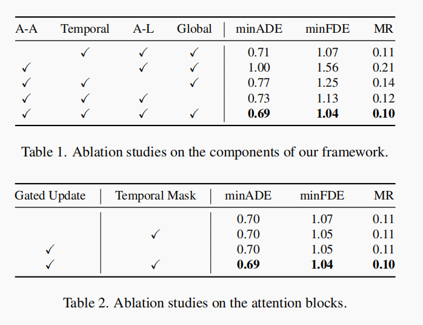
### Results
表现在当时SOTA，推理速度60多毫秒（local半径50m，用的设备也比较一般 2080）
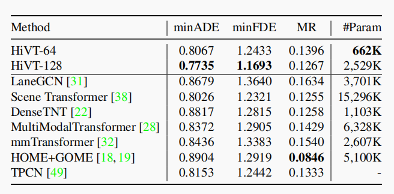
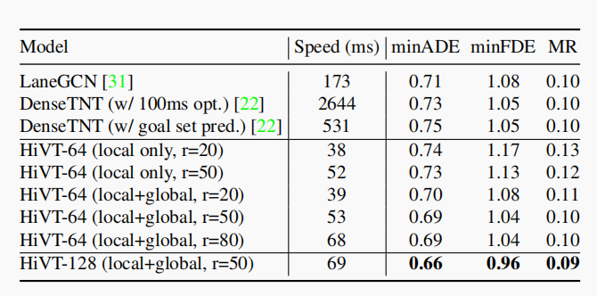
一些预测结果
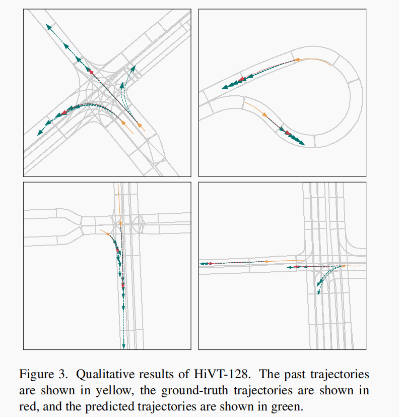
