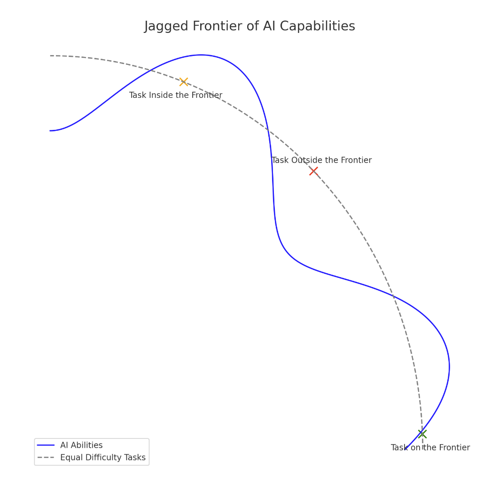
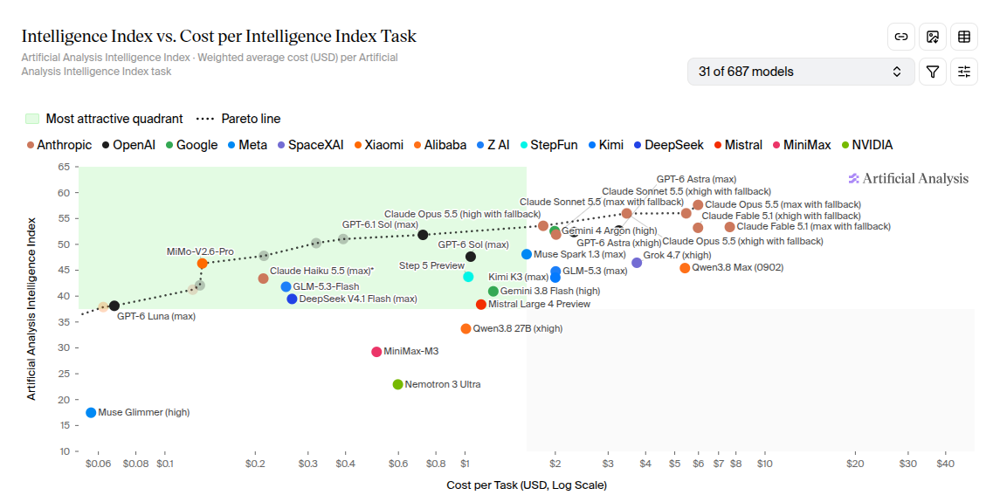
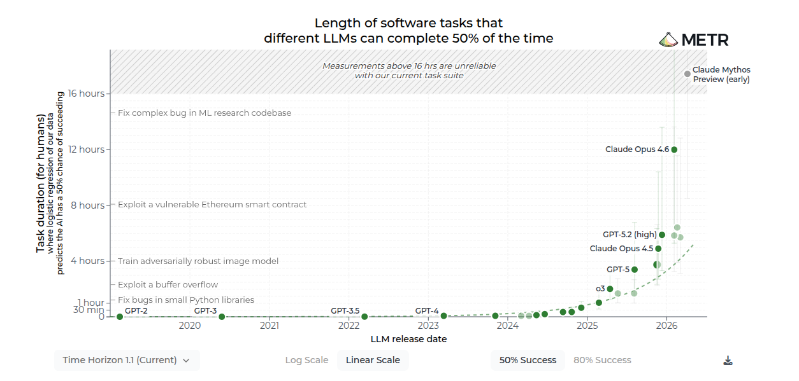
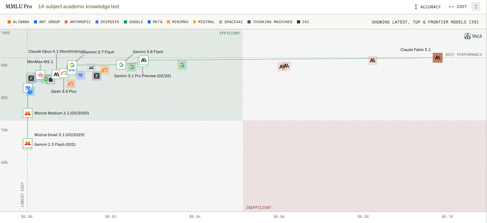
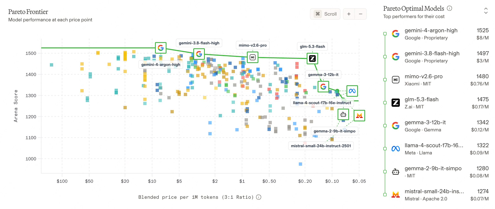
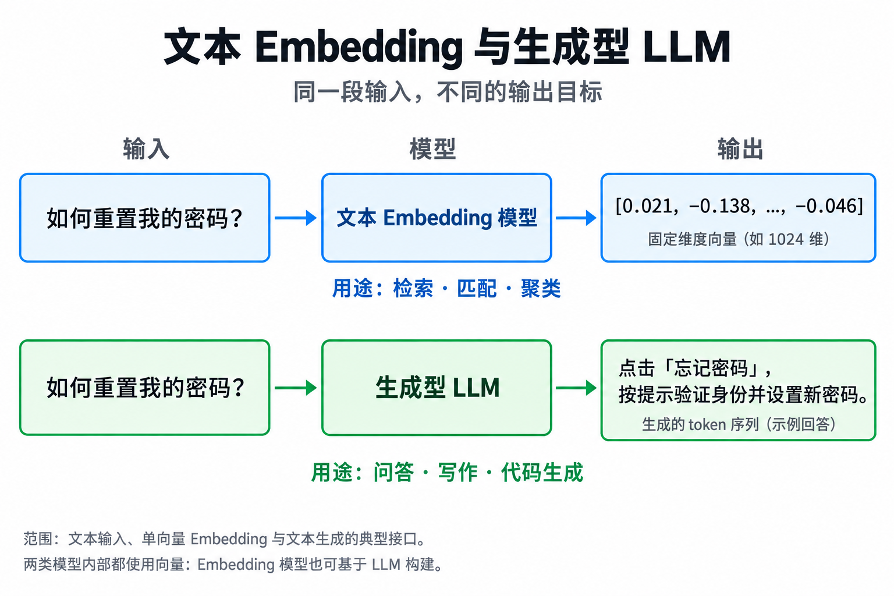
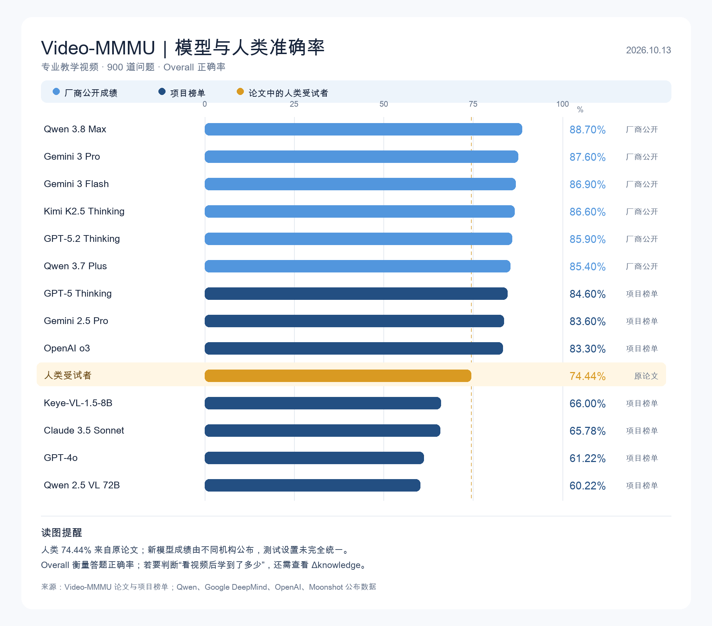
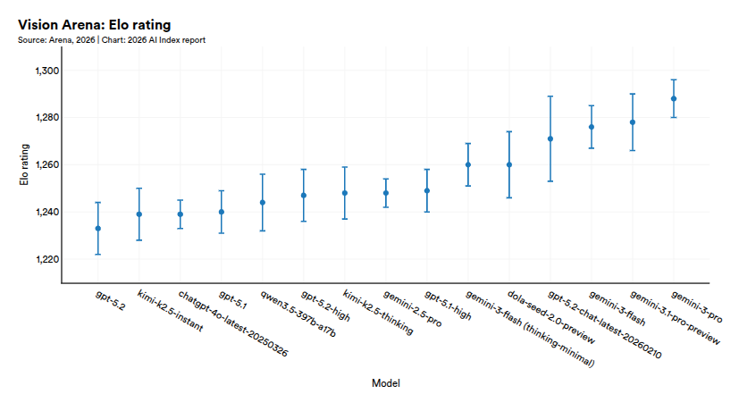
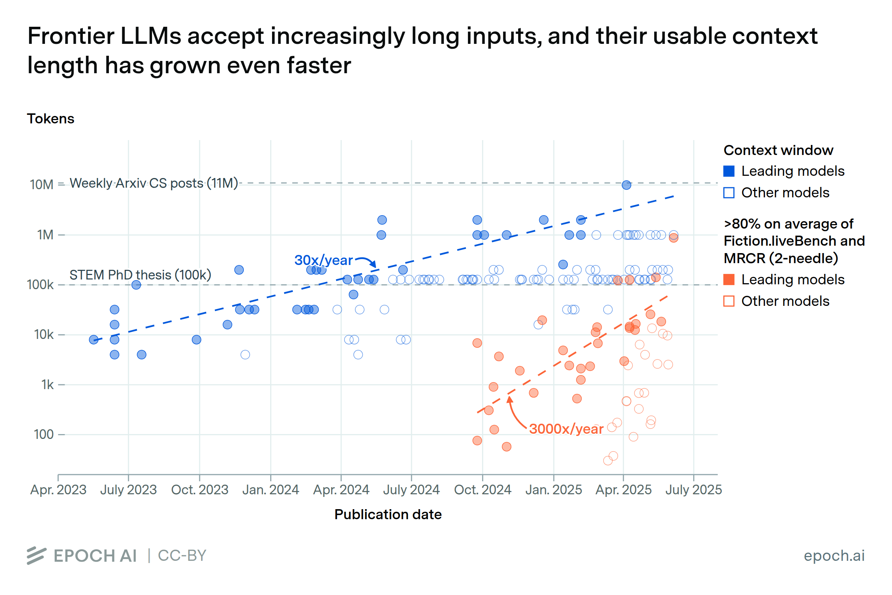

> 在2026年，AI的能力边界在哪里？

## 能力边界定义

最初人们认为AI的能力是实验室中的试验品，是特定任务领域的解决方案（图像/语音识别）。但在2022年ChatGPT的发布，使得AI能力第一次真正走入大众视野被大家广泛使用。23年GPT-4现象级的推出，彻底开始了此次AI大基建和大革命。23年GPT-4只能生成高质量文字，24年2月Sora便能够生成高质量视频，5月OPENAI发布GPT-4o，将推理过程中的思考过程可视化，真正看到了推理过程的思维链。24年春节Deepseek发布的V3/R1，在成本大幅降低的情况下，实现较高的模型性能，引起行业地震。25年至26年，Anthropic、OPENAI、Google又在模型性能上疯狂军备竞赛，国内Kimi、智谱、千问的模型性能也在大幅提升。各种类型的任务，都被AI逐步掌握。

AI能力迅猛发展的今天，其能力边界正被不断扩张，其实很难给出一个确切的定义。但有一些概念和思想，是通用的，可以用来指导我们理解。

### 锯齿状的能力边界

在[Navigating the Jagged Technological Frontier](https://mitsloan.mit.edu/sites/default/files/2023-10/SSRN-id4573321.pdf) 一文中，提到了Jagged Technological Frontier的概念，即技术能够影响的边界是锯齿状的，而非平滑的。这篇2023年的论文，在chatgpt4发布的基础上进行实验和讨论，虽然实验具体的任务对于2026年的模型已经基本被更好解决，但是作者也同时预测到“模型的能力还在迅速增强，但是其在处理不同类型任务的能力上，还是存在不平衡的情况”。

*图片来源：[Navigating the Jagged Technological Frontier](https://mitsloan.mit.edu/sites/default/files/2023-10/SSRN-id4573321.pdf)*
对于人类来说相同难度的任务，可能对于AI来说难度是各不相同的，这造成了AI能力的锯齿状边界。

### 边界的维度

对模型能力的评测是一件必要且复杂的事情，在[HELM](https://arxiv.org/abs/2211.09110)之前，对于模型的评价都是碎片化非体系的。其主导使用透明、全面且标准化的模型基准测试与评估体系。核心思想评估理念是将评估拆解为多个维度。这些维度对后来的大模型评估产生了结构性的影响。

核心能力包括：准确性（Accuracy）、鲁棒性（Robustness）、安全性（Safety）、校准度（Calibration）

社会影响方面：偏见（bias）、毒性（toxicity）以及版权和隐私风险

效率和成本上考虑：推理延迟（Latency）、Token消耗和计算成本（Cost per task）。

目前常见的顶级评测项目有[Arena](https://arena.ai/)：对用户匿名模型进行公开评测
[Artificial Analysis](https://artificialanalysis.ai/)：综合提供多项能力测试
主流的大模型评测集有MMLU（Massive Multitask Language Understanding）：多学科综合考试
GPQA Diamond：专业科学知识和推理能力
Humanity's Last Exam：高难度综合知识与推理
SWE-bench：真实软件功能能力

*图片来源：[Artificial Analysis](https://artificialanalysis.ai/)*
*Cost per Task vs Intelligent Index*

### 与人类工时对比

能力边界在不断拓宽，各个维度边界在生长，但是这个过程中，模型能力随时间如何增长，相对于人类能力，如何界定才算“能做”？

[METR](https://metr.org/time-horizons/)则提供了评测模型这一能力的框架

其核心思想是：人类专家在某段时间内能完成任务的基准上，AI模型能够在50%和80%的成功率下完成任务的最长时间。以人能够直觉理解的工时作为基准，可以看到模型能力的50%成功率最长工时时间，随着时间的推移其翻倍时间在不断缩短。

*图片来源：[METR](https://metr.org/time-horizons/)*

## 目前已经能做什么

这里主要参考Stanford的[AI Index 2026报告](https://hai.stanford.edu/ai-index/2026-ai-index-report)，这篇报告全面的展示了2026年AI在各个领域发展的现状。对于应用者和解决方案提供者，更重要的是了解模型在边界内外的表现差异，以帮助解决具体的实际需求，所以参考重点主要在Technical Perfomance部分。

### 文本相关能力

目前模型已经具备比较强的文本理解与表达能力，但需要对“答得好、找的全、做得对”进行详细的了解

#### 文本理解与知识问答

目前已经在[MMLU-Pro](https://arxiv.org/abs/2406.01574)多学科选择题上达到约87%~92%的成绩，MMLU-Pro标准通常指达到或超过各个领域前10%熟练的人类水平，共包含1.2万道题和14个学科，覆盖数学、物理、计算机、法律和历史等。主要观察模型的知识广度，以及运用知识推理解题的能力。这一指标因模型成绩趋于饱和，不再能显著区分模型水平，已经在近期停止测试新模型。

*图片来源：[VALS MMLU PRO评测](https://www.vals.ai/benchmarks/mmlu_pro)*

#### 文本生成

文本生成的质量通常在评估时依赖人类的主观判断，同时质量高低取决于用户的prompt输入，所以通常是像[Arena](https://arena.ai)这样的项目，让使用者对模型输出质量进行评价，来作为模型文本生成质量的部分打分依据，目前看领先的模型都能够较好的生成连贯的回答。

*图片来源：[Arena](https://arena.ai)*

#### 检索与工具连接

在模型实际部署使用过程中，通常需要将模型输出与外部工具进行链接，以完成复杂的任务。目前在文本方面主要有3个主要的能力：RAG（retrieval-augmented generation）、function calling和test embedding，这三方面的能力决定了模型在较复杂系统中实际表现能力。

RAG功能的出现主要是为解决检索增强生成（retrieval-augmented generation）的能力，即模型能够在生成文本时，能够从外部知识库中检索相关知识，以增强生成内容的准确性和相关性。通过检索到的相关知识，模型能够更准确地理解任务背景，从而生成更准确、更符合上下文要求的回答。最早在2024年微软研究院提出的[Graph RAG](https://arxiv.org/abs/2404.16130)中被提出，使用方可自行搭建检索流程或使用第三方模型公司已经搭建的工具链实现RAG功能。

Function calling能力允许模型调用外部工具或API来生成结构化的request返回给模型，以用于多轮重复这个过程来完成复杂的任务。这也是Agent工具最底层的基础能力，有这些工具和外界提供的其他能力，模型将远超越已有自身训练参数所带来的能力。[Berkeley Function Calling Leaderboard（BFCL）](https://gorilla.cs.berkeley.edu/leaderboard.html)是用于评判模型此能力的项目。目前从公开评测来看，前沿的模型已经能够完成工具选择、参数填写、多工具调用、以及根据返回结果继续执行的能力。后续更多模型使用者其实更关注function calling带来的端到端agent效果的评测，较少关注function calling这样细分能力的评测。

Text Embedding能力则主要用在检索类agent中，模型能够理解输入的语义，主要用于从知识库中检索相关知识、进行相似度比较和聚类等任务。[MTEB](https://arxiv.org/pdf/2210.07316)则提出了大规模文本嵌入评测基准，目前已经能够较好的处理用词不同、含义相关的匹配，以及跨语言的检索以及跨模态的检索功能。

### 图像和视频处理

#### 视频理解

视频理解能力要求模型能够从视频中学习，跟踪多帧间的行为、目标和相关事件，并从在视频学习后迁移知识用于后续任务。经典的benchmark有[MVBench](https://huggingface.co/spaces/OpenGVLab/MVBench_Leaderboard) 将视频模型的temporal understanding（时序理解）拆分成了20类任务，用于判断一个模型到底有没有真正理解动作顺序、状态变化和交互。

更复杂的benchmark有[Video-MMMU](https://arxiv.org/abs/2501.13826) ，将题目分为感知、理解和迁移三个层次。感知部分需要模型能够从视频中获取关键信息，理解则需要其抓取视频主要概念和相关事件，而迁移则需要将学习到的这些知识在新的场景中进行运用。在Video-MMMU的人类基线准确率是74.4%，而目前最前沿的模型能力已经超过了这一数字，[MMMU-Video最新eaderboard](https://github.com/EvolvingLMMs-Lab/VideoMMMU#-video-mmmu-leaderboard) 

#### 图像和视频生成

视频生成领域也在不断发展，评价主要是在画面质量和内容是否成立两个方面，画面内容是否清晰美观，运动是否看起来自然。内容成立上看人物和物体是否保持一致，动作是否符合要求，物理过程是否合理。在这个评价过程中还是有主观人类打分和客观评价两种评测方法，Arena Vision就是使用人类主观感受来对模型效果打分，因为对美感的评价目前无法使用自动的评测标准来评价。目前Gemini的模型在视频生成方面打分较高。同时还有Video-Bench、VBench-2.0这样的评测项目。

*图片来源：[Stanford AI Index](https://hai.stanford.edu/ai-index)*

同时在2025年[Google DeepMind的一项研究](https://arxiv.org/pdf/2509.20328)中发现,如Veo3这样的视频生成模型，可以解决一些训练过程中从未涉及的视觉任务，同时存在零样本任务特性，能够完成边缘检测、图像分割、浮力和刚体特性的物理建模这些从未训练过的任务。

### 推理归因能力

#### 通用推理能力

通用推理能力主要指模型解决不熟悉的问题能力，不依赖与已有训练数据中的领域知识或记忆模式，比如计算长整数的乘法，而不是仅仅尝试生成看起来对的答案。[MMMU](https://mmmu-benchmark.github.io/)（Massive Multi-discipline Multimodal Understanding）评测主要针对大学级别的学科问题进行评测，需要模型通过图表、表格以及学科专业图示进行推理回答问题，目前各个前沿模型也基本达到了人类专家高水平参考组的基准。

GPQA则是一项研究生级科学问答评测，测试模型能否结合专业知识完成多步推理。在2024年GPT-4早期在这项评测集上的准确率大概是38%左右，而在2025年底，openai相关模型已经能够达到90%以上的水准。
![[Pasted image 20261014212121.png|529]]
*图片来源：[Stanford AI Index](https://hai.stanford.edu/ai-index)*

Humanity’s Last Exam (HLE) 被称作人类最后的考试，是跨学科的专家级问题测试模型。2025年最前沿模型的准确率在38.3%左右，而在最新的测试结果中，GPT-6 Astra 为 **59.9%**、Gemini 4 Argon 为 **56.9%**、Claude Opus 5.5 为 **54.6%**。GPT-6 Astra 在允许网页和代码工具时达到82.9%。它说明模型解答专家级、可核验学术问题的能力进步很快。
![[Pasted image 20261014212813.png]]
*图片来源：[HLE-Diamond](https://lastexam.ai/blog/hle-diamond)*

### 特定领域能力

#### 软件开发

目前已有评测标准对模型解决Github中的真实issues、从零开发web应用，以及端到端可交付的软件工程能力进行评测，比如SWE-bench、Terminal-Bench以及Vibe Code Bench。其中SWE-bench的测评能力基本已经饱和，顶尖模型对于例如读懂一个中型Python代码库、定位bug以及写出通过测试补丁这类任务已经超过了人类工程师的水平。Terminal-Bench则证明目前模型能够在真实终端里完成编译、配服务器、训练模型等多步骤终端工程任务。而在Web应用的开发能力上，Vibe Code Bench证明顶尖模型目前已经能够从零部署可用的Web应用。

#### 数学领域

GSM8K（小学应用题）和MATH（高中竞赛数学题）已经完全饱和，前沿模型甚至不用顶尖模型已经达到了接近100%的准确率，算术、初高中数学、常规代数微积分对其已经无难度。而Frontier则是由百道数学家专家、未公开的研究级难题，目前也基本都达到了90%以上的回答准确率。同时数学也是饱和最快的类别，基本新基准被提出后，短时间内就会被模型刷穿指标。但是新出的评测数学题对于模型而言，也能取得不错的准确率。

#### 金融&法律

目前模型已经能够承担一部分金融分析师的具体工作，比如查报表、整理经营数据、计算指标、搭建估值模型和撰写研究初稿。法律领域已经出现了很强的阅读、检索和起草能力。相关评测指标有CaseLaw和LegalBench。

### 具身智能&&自动驾驶

AI想真实在物理世界产生价值，除了在屏幕上处理文本和图片，需要其载体在物理世界中感知并处理具体的物理任务。目前主流的方法是尝试采用VLA模型来替代传统的感知、规划和控制，直接通过摄像头输入和语言指令来完成控制。Physical Intelligence团队的[π系列模型](https://www.pi.website/blog/pi07)，目前在演示中已经能够完成一系列简单的家务工作。NVIDIA的Isaac GROOT系列也是VLA的代表，侧重机器人技能，以及配套的数据、仿真和部署工具，同时英伟达也在向世界动作模型方向推进。Google DeepMind团队推出的[Gemini Robotics](https://deepmind.google/blog/gemini-robotics-2-brings-whole-body-intelligence-to-robots/)则扩展到全身控制、灵巧操作和多机器人写作，其中ER模型负责较高层次的理解与规划，VLA负责动作执行。目前具身智能已经从单项演示，进入了多任务泛化和真实场景试用阶段。通用机器人的可靠性任然是核心难题。

![[Pasted image 20261018202503.png]]
*图片来源：π07*

自动驾驶领域已经不再是实验室中的产品，目前已经开始了小规模的商用。Waymo在全美有2500辆robotaxi正在运营，每周的接单量达到了45000单。亚马逊旗下Zoox则也在美国有小规模的运营。中国则是Apollo Go在整个2026年一季度完成了320万次无人运营行程，8月披露全球业务达28城。小马智行则截止2026年6月底，全球Robotaxi车队约有1975辆，正在推进海外合作部署。文远知行也在截至2026年7月底，全球的Robotaxi超过了1800辆。

在安全性上，美国NHTSA管理局则需要运营商提供真实道路事故的报告，从报告开始被要求提供之后，每月的自动驾驶交通事故在增长，这也因为运营的车辆在增长，不好解释是否是自动驾驶安全问题导致。而Waymo则评价了在相同里程下，提供的自动驾驶服务和人类驾驶员在不同场景下的能力表现，目前基本在所有场景下，自动驾驶的能力都超过了人类。在5670万英里全无人驾驶里程上的研究表现，相较于人类驾驶基准，涉及疑似重伤或更严重伤害的事故率，降低约 **85%**，而路口车辆碰撞中涉及伤人的事故率，降低约 **96%**。但最终还要考虑到自动驾驶实际运营区域有一定限制，在突发情况下还需要人类介入。

![[Pasted image 20261018205318.png]]
*图片来源：Stanford AI index*

## 边界主要在哪里

### 处理超长上下文能力

模型支持的上下文长度context，这一指标从2023年中约数10K，以每年差不多30x的速度增长，在2026年最前沿模型支持的最大上下文长度已经达到了1000K。而在类似Fiction.liveBench、MRCR这样的长上下文任务评测中，在以达到80%准确率为标准的前提下，最前沿模型能够处理的上下文甚至以3000x每年的增长速度在野蛮增长。

看似模型在吞噬所有长上下文任务，是不是？要知道1000K的上下文长度，相当于多本普通数据或一整个代码库的所有代码。但是在某些专家任务中，发现模型能够处理上下文长度的增长和能够深度理解这些上下文，实际上还有很大的gap。一项专家级别的[长上下文评测LongBench v2实验中](https://aclanthology.org/2025.acl-long.183.pdf)中，发现人类专家专家在评测集上的得分约为53.7%（15分钟限制下），而最强大的模型达到57.7%，相较于其他指标显著超越人类专家，在这项评测上，模型的优势并不明显。

而在[Yu et al.,2025](https://aclanthology.org/2025.findings-emnlp.301.pdf)的发现中，超长上下文的回答质量并不如循序渐进的prompt引导下那么好，以及在超长上下文下对于多线索的索引和寻找能力上也表现一般。同时如果一次性使用较长的上下文，模型的相应时间和计算成本也会大幅上涨。也许Transformer架构下的LLM模型，如果想无限制的拓展上下文，必然无法避免计算复杂度和显存的瓶颈。

如果上下文长度和有效信息利用上能够做到更好的平衡，同时研究更完善的评测方法。相较人类，也许模型在长上下文任务中能够展现更大的优势。

*图片来源：[epoch.ai](https://epoch.ai/data-insights/context-windows)*

### 视频生成无法真实模拟物理过程

虽然在上述提到的Google DeepMind的研究中发现Veo3这样的模型能够生成表达浮力或刚体特性的视频。但是在2026年也有部分研究发现（[RigidBench研究](https://arxiv.org/pdf/2608.15555)），发现大多数生成的视频无法真实模拟物理过程，模型只是生成了符合人类偏好评测中的“真实物理”，并不能证明存在物理过程。

### 法律和金融特定领域能力有待提高

目前在较为复杂的金融业务中，准确性和完整性仍不足以支持全程无人复核。同时也暂时没有证明模型的投资能力，是否能够具备长期决策的能力。而在法律工作中，模型可能可以找出合同的责任上限，但却漏读另一处“某类责任不受该上限限制”的例外，同时法律工作中特别需要考察遗漏和例外处理能力，这些是模型目前仍难以具备的。

### 具身智能数据远远不足

现在许多benchmark证明涉及真实物理世界的任务相对AI是最困难的，环境中存在不可预测性和随机性。传统的机器人任务通过固定程序和任务动作来回避这个问题，但是当环境发生变化，需要其处理更为复杂的任务时，这种方法显然不够。而最大的限制，在数据。语言模型能够从互联网获得巨量的数据用于训练，而具身智能模型生产数据需要在高分辨率物理仿真模拟或真实世界中进行获取，这些都进展很慢且造价昂贵。目前具身智能尝试使用世界基础模型来解决此问题，但还在实验室的研发阶段，距离真正的应用目前还有距离。

#### 一些有趣的发现

模型能够回答归因专家级别的专业题目，但是在识别模拟钟表时的表现却距离人类相差较远。模型在区分不同类型的指针时容易混淆出错，同时较难在单张图片中寻找多条视觉线索。但这一指标目前随着前沿模型的迭代，正在慢慢逼近人类水平。