文章链接：[https://arxiv.org/abs/1906.09788](https://arxiv.org/abs/1906.09788)

代码链接：[https://github.com/HKUST-Aerial-Robotics/spatiotemporal_semantic_corridor](https://github.com/HKUST-Aerial-Robotics/spatiotemporal_semantic_corridor)

最新SSC生成代码：[https://github.com/HKUST-Aerial-Robotics/EPSILON/tree/master/util/ssc_planner](https://github.com/HKUST-Aerial-Robotics/EPSILON/tree/master/util/ssc_planner)

# 简述

* 难点问题

主要解决的难点问题聚焦于 如何在urban environments中有效表示semantic elements的约束形式，以及 如何确保生成的轨迹既可行又安全。
    * 1.对于不同类型的道路交通语义元素，分别设计cost和constraint进行组合用于优化，想达到泛化性强、稳定的规划效果并非易事（需要大量tune和特定设计）
    * 2.现有常规优化方法或者lattice-based算法都是基于采样，无法完全保证采样点之间生成轨迹的安全性

* 文本主要解决问题
    * 通过Spatio-temporal Semantic Corridor(SSC) 来描述语义元素，在所有的交通场景中，语义元素均可被统一表示为具备明确时空范围的时空障碍物，SSC为一系列无碰撞且相互连接的cube拼接形成
    * 在有SSC后，在其约束内部通过quadratic programming (QP) 求解 piecewise Bézier curve，因为贝塞尔曲线的优良凸包性质（proposed formulation is built on the top of the convex hull and hodograph properties of the Bezier curve）

* 核心工作
    * 1.SSC能够统一描述复杂城市场景中的多种语义元素
    * 2.提出的基于贝塞尔曲线的轨迹生成优化方法，能在整个轨迹生成过程中保证安全性和可行性
    * 3.轨迹生成优化框架完整，multi-agent仿真场景时效性得到保证，实验论证完备

* 基本框架
    * Behavior Planning（provides a preliminary initial guess about the future states）
        来自prediciton和routing的输入
        使用multi-policy decision making（MPDM）， 不限于这个决策模块
        输出：得到forward simulated states（未来离散状态）

    * Motion planning
        来自behavior planning层的输入：which takes discretized future simulated states from the behavior planner as seeds for corridor generation
        * SSC的构造输入
            * 包含语义信息的语义地图（a semantic map which consists of the semantic elements）
            * 动态障碍物的预测轨迹
            * initial guess（forward simulated states）
            * 参考线（a reference lane given by the route information）
        * 分段贝塞尔优化
            输出：规划轨迹
        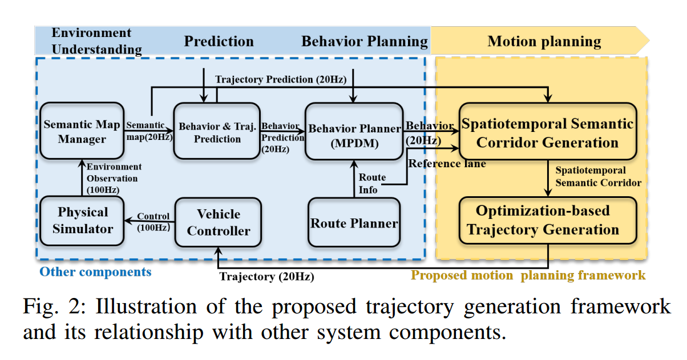

# Related literature 

* 时空规划（spatio temporal motion planning）

主要是基于采样和搜索的方法，
    * sptaio-temporal state lattice：没有统一描述复杂语义元素，需要特定设计规则和利用GPU计算进行加速
    * search base方法：面临搜索空间维度爆炸的问题

在时空语义元素的表述方法上，
    * 基于风险场：需要特定设计各种cost function，并表述为风险场（specially designed cost functions and aggregate the cost terms），存在local minimums问题
    * 横纵向障碍物和约束处理：动态障碍物、红绿灯、道路标线表述为在时间域的横纵向障碍物，需要权衡不同障碍物类型间的cost

* Corridor生成
    * spatio corridor：通过在initial path附近生成平滑的可行驶凸空间，轨迹优化通过二次约束二次规划，无法处理动态障碍物
    * convex feasible set方法：通过convex feasible set algorithm (CFS)算法寻找非凸问题中的convex set和constraint，实时性根本无法保证

本文使用的corridor生成方法能够统一表述时空域中各种语义类型的障碍物，同时不用设计和考虑特定类型约束的设计和权重权衡。

# 方法

## Behavior Planning
非本文核心工作，当环境中车辆数量激增时，使用多智能体的POMDP问题计算负担较重，MDPM将问题简化为有限的闭环离散策略，自车和他车的预测都通过简化的模型前向模拟来实现，并且结合理想化的转向和速度控制器来评估最佳行为。
MPDM主要用于生成初始未来离散状态，可以提供多种maneuver的未来模拟状态，用于启发生成未来corridor。
离散未来状态由于粗糙的分辨率，无法直接用于执行，交由下层进行进一步优化。（Although the initial seeds are collision-free, they can not be directly executed by the vehicle due to a coarse resolution (0.15 s in the experiments) ）

## SSC表示&生成
### 表示
* Spatio temporal Corridor构型空间：Frenet坐标系下 S-L-T
* 语义障碍物分为两种
    * Obstacle-like semantic elements：static/dynamic obstacles，在SLT空间中表示为 3D occupancy grid
    * Constraint-like semantic elements：时域/空域上的限制，例如交通规则限制。举例：
        * 路段限速（regarded as the velocity constraint applied to a longitudinal range [s_begin; s_end]）
        * 变道时长限制（a time constraint applied to the lateral range [d_begin; d_end] of the current lane）

### 生成
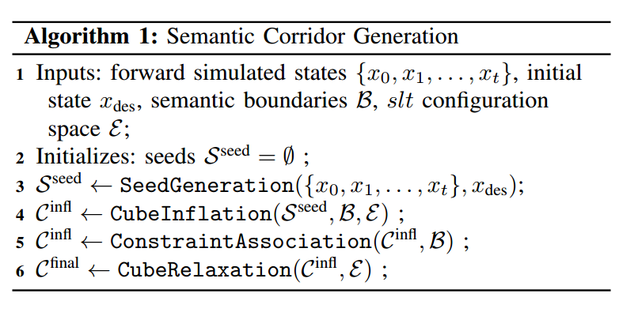
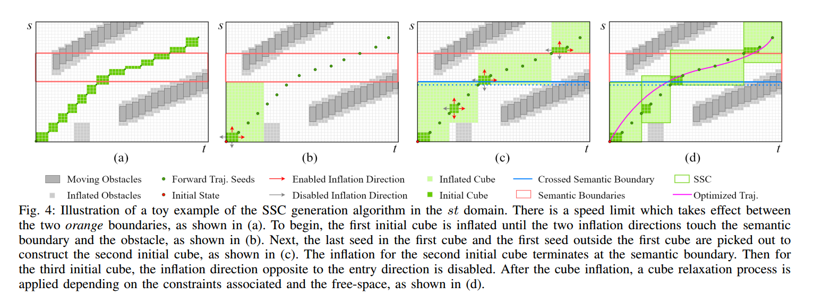

* 输入：包括behavior planning层给出的初始状态序列、语义障碍物/约束边界、slt构型空间
* Seed Generation：通过将初始状态序列投影至slt空间中
* Cube Inflation：遍历初始状态（seeds）
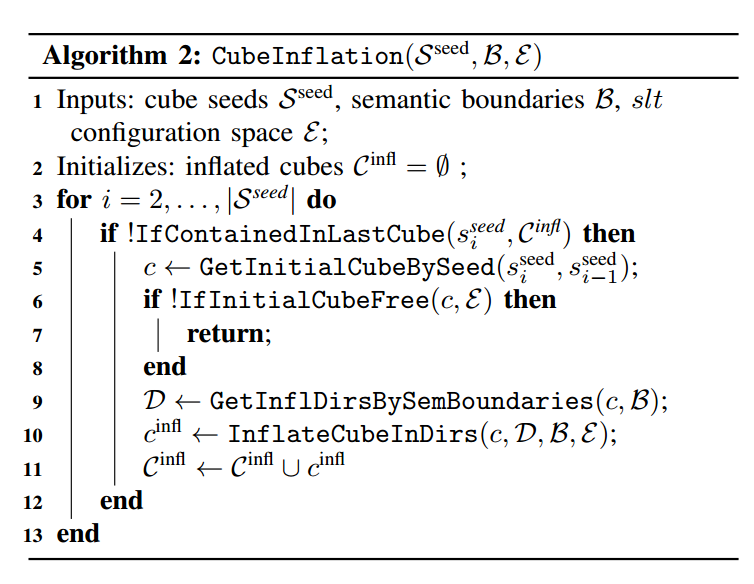
    * 初始化cube：通过两个连续的seed做为顶点得到cube，最终结果如图（a）深绿色区域
    * 确定膨胀方向：通过碰撞检测得到初始cube的膨胀方向（when the initial cube intersects with a certain semantic boundary, the inflation direction opposite to the entry direction is disabled）
    * 膨胀cube：在膨胀方向上，单步长迭代膨胀cube，直到与语义边界发生相交，最终结果如图（a）和（b）
    * t维度对齐：同时如果想得到凸空间进行后续优化，当前cube的时间上界应该与next cube的时间下界相等。当然也可以将cube之间的t重叠处理，当作非凸问题进行优化

* Cube Relaxation：可以对交通规则等约束处理为soft constraint，如图（d）中蓝色虚线

### SSC数据结构
包含 DrivingCorridor 和 3d original/inflated grid map
```cpp
template <typename T, int N_DIM>
struct AxisAlignedCubeNd {
  std::array<T, N_DIM> upper_bound;
  std::array<T, N_DIM> lower_bound;

  AxisAlignedCubeNd() = default;
  AxisAlignedCubeNd(const std::array<T, N_DIM> ub,
                    const std::array<T, N_DIM> lb)
      : upper_bound(ub), lower_bound(lb) {}
};

struct DrivingCube {
  vec_E<Vec3i> seeds;    // 来自MPDM的初始离散状态
  AxisAlignedCubeNd<int, 3> cube;  // cube在SLT维度上的上下界
};

struct DrivingCorridor {
  int id;
  bool is_valid;
  vec_E<DrivingCube> cubes;
};

common::GridMapND<SscMapDataType, 3> *p_3d_grid_;
common::GridMapND<SscMapDataType, 3> *p_3d_inflated_grid_;
```

## Trajectory Generation
主要思想是为了在SSC的约束中，保证生成轨迹的安全性和可行性
* 为什么没有使用五次多项式？
    * （1）表达能力比较弱，在SSC中可能求解失败
    * （2）多项式曲线的拟合只考虑了采样点约束,无法考虑到整个 convex hull 的约束

### Bezier Basis and Its Properties
* 定义：m阶的贝塞尔曲线是由m+1个控制点定义
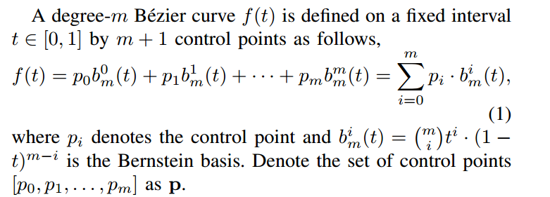
* 性质
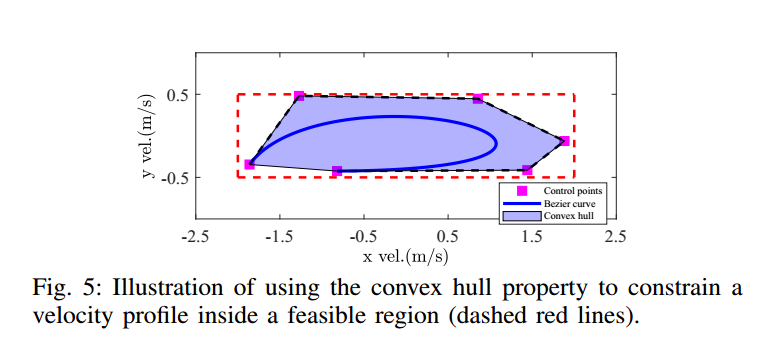
    * 凸包性：bezier曲线从数学上保证是在 convex hull 里的
    * hodograph property：facilitates constraining high-order derivatives of the Bezier curve, which is useful for enforcing dynamical constraints，m阶贝塞尔曲线的m−1导数后的曲线仍旧为低阶的贝塞尔曲线

### Piecewise Bezier Curve Representation
* 分段bezier曲线表示
每一段bezier曲线对应一个时刻t的SSC，包含s、l两个维度
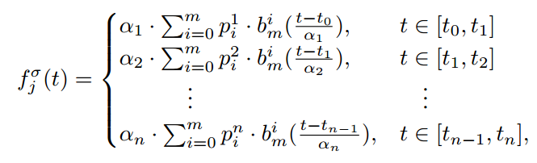
* 目标函数
横纵向jerk的平方加权和，i代表第i段
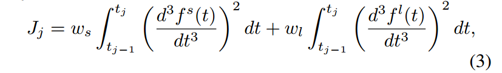
可以化为贝塞尔曲线形式
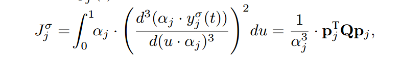
* 安全性和可行性约束
    * 理论依据
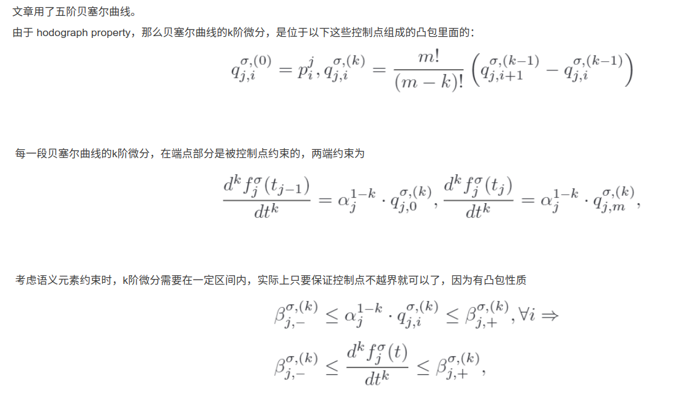
    * 相关constraint
        *  Desired state constraints
        其实就是轨迹的两端约束，保证轨迹的起点和终点符合期望
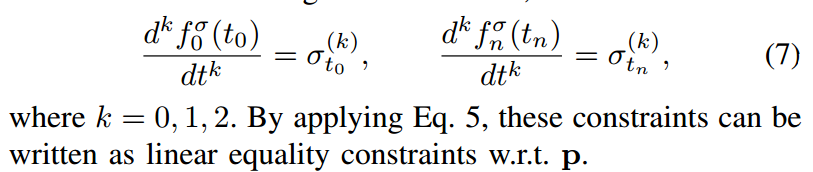
        * Continuity constraints
        分段曲线的连接处要到三阶导连续
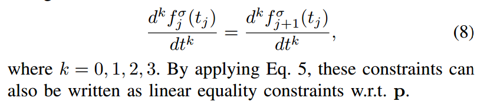
        * Free-space constraints
根据凸包性质和理论依据中的公式，无碰撞约束可使用下面公式的零阶导形式
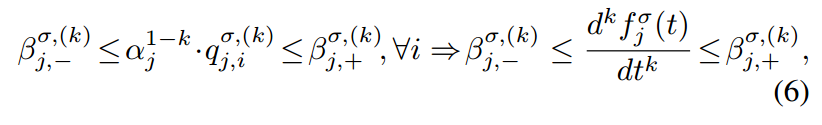
        * 横纵向速度/加速度约束：上面公式的k = 1,2阶形式
* 求解器：OOQP

# 实验
## Implementation Details
* 测试场景：real satellite maps via QGIS
* 硬件：Intel I7-8700K CPU
* 运行频率：20 Hz

## Qualitative Results
在三种复杂场景进行了定性实验分析：
* merge in：包含变道和lane keeping两种潜在行为，分别优化了trajectory。体现了SSC对语义元素约束的统一描述效果
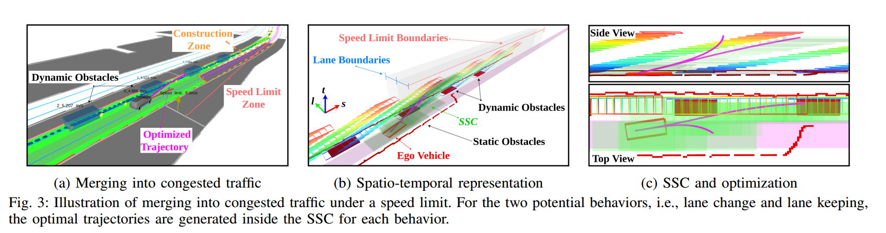
* 城市快速路overtake
our method conducts a safe and smooth overtaking on an urban expressway with a speed of around 20m/s
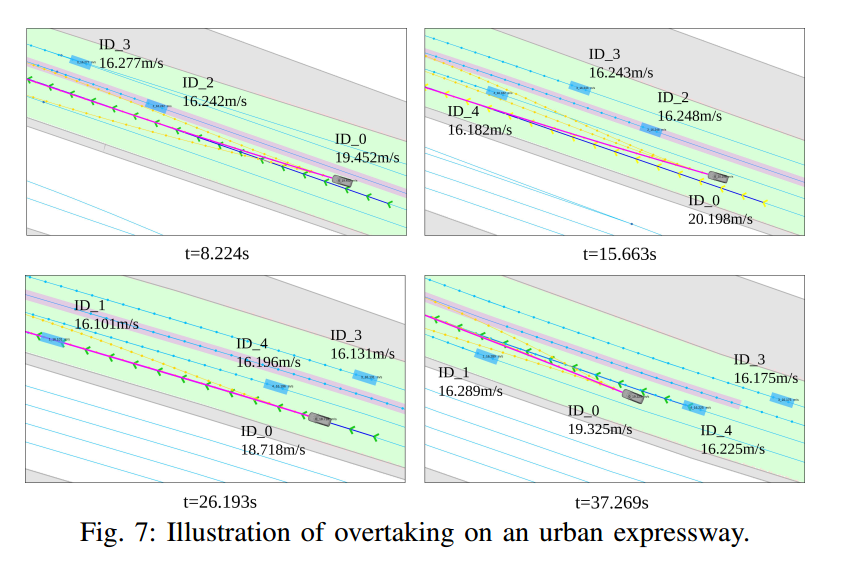
* 无保护左转
近接路口时因为对向直行车存在，减速等待时机到来快速通过，包含硬限速和软边界约束（lane boundary）
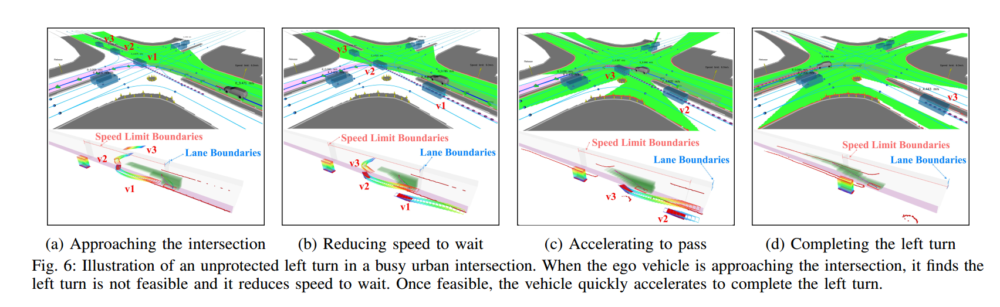

## Comparisons and Analysis
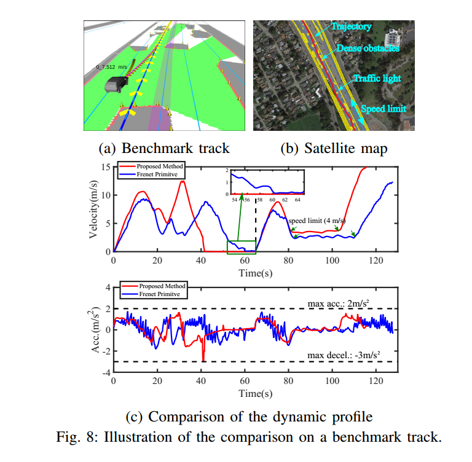
与另一种方法（which is based on optimal primitives in the Frenet frame）进行实验对比
实验结果：
* 通行效率更高，同时加速度曲线更平滑（our acceleration profile is smoother while staying within the dynamical limit）
* Precise stop with a high entry speed
* Collision avoidance under a low speed limit，优化轨迹能够严格的满足限速约束

# Q&A
1. SSC还是在Frenet坐标系下建立的，显然在大曲率下的障碍物投影和物理边界投影还是会存在问题？
2. behavior层还是较为依赖预测信息，无法建模交互不确定性，作者自己也说了
3. 论文没有进行定量分析，只是定性分析了个别场景，同时看实验结果，还需要实际对规划体感进行优化
4. 对于不同行为的SSC建图，还是需要大量的手动设计规则（for different behaviors, the strategy for choosing the local target is different），类似曲率/经验限速，障碍物筛选和软硬处理