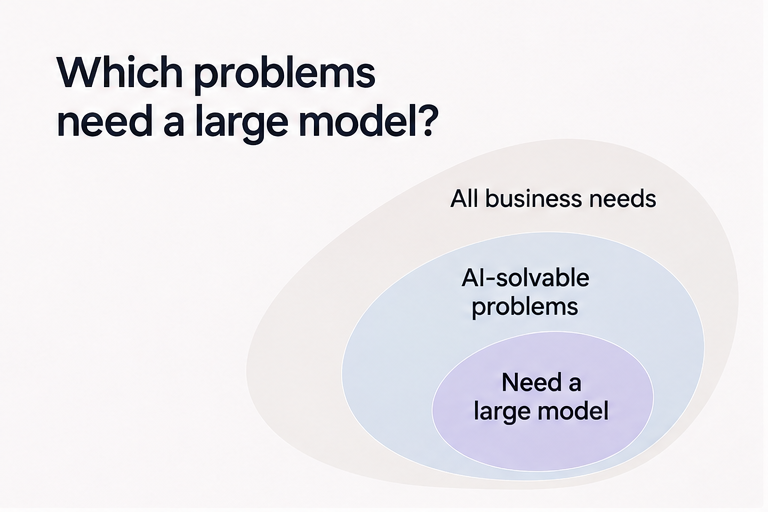
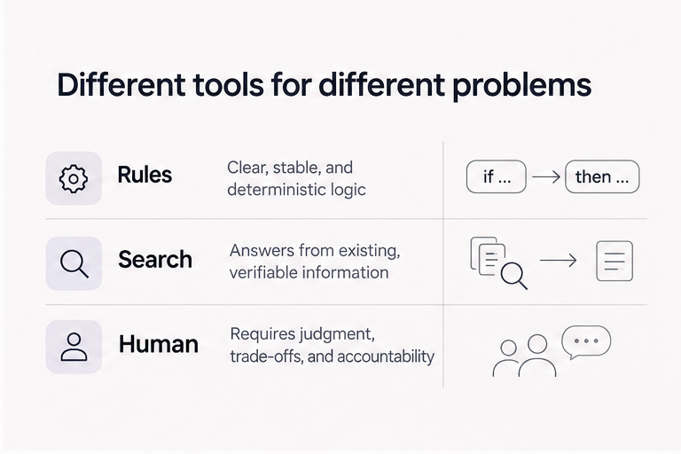
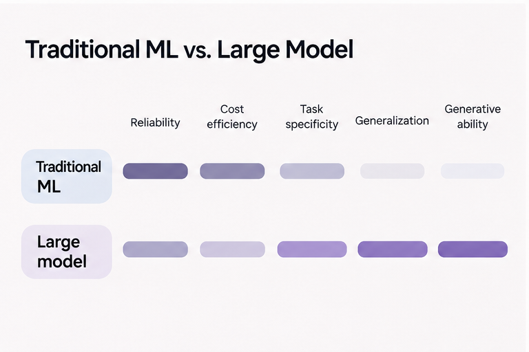
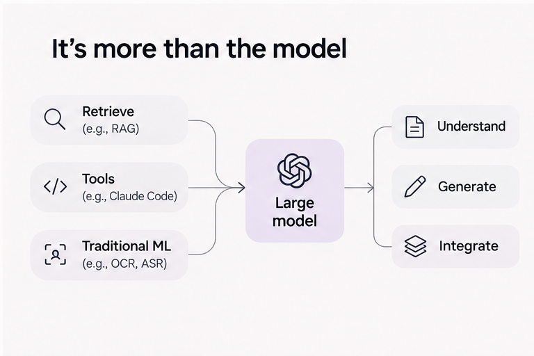

## 什么样的业务需要大模型？

也许是因为工作属性的关系，工作和生活被各种AI叙事充斥，让人感觉模型就要统治世界了。诚然，模型的能力越来越强，为了达成业务需求所搭建的某些配合模型的外壳，也在大力飞砖的模型迭代过程中不断被侵蚀。FOMO情绪也使得更多的人投入到了大模型的应用创业热潮中，但是真正实际需要落地的业务，需要考虑的远不止fancy的大模型本身，还需要考虑业务稳定性、安全性、用户体验以及成本等等方面。

所以真的所有真实产品和业务需求，都需要大模型吗？

如果答案是肯定的，那么理解为什么所有业务都需要大模型，能够让我们对模型在业务中落地有更清晰的认识。如果答案是不确定或者否定的，那么我们需要思考，究竟在哪些需求和实际业务中，我们需要大模型的能力来提升产品表现甚至重构产品。而哪些类型的业务，我们可以通过已有的成熟解决方案解决，大模型的解决方案去解决更应该解决的问题。

### 规则、搜索和人工

规则：能够通过条件明确、稳定高效标准化处理的产品业务，比如社交应用中用户名的检查、电商系统中折扣金额的计算、政务系统中输入字段和日期的非法格式检查等。这些正确完整被规则能够定义的功能，这些任务需要的是严格执行约束，引入模型处理，会带来稳定性的下降，而产品能力也并不会得到提升。

搜索：产品的输出来自外部世界的真实事实或材料，比如社交应用中的账户查询、企业内部知识库的文档索引（非推荐）、电商系统的订单查询等，这些任务的真实数据和结果来自外部客观存在的信息，产品功能的输出过程更多依靠索引，引入模型处理，带来的是事实结果的不确定。

人工：业务和产品目标需要进行沟通讨论，过程需要监管，价值需要取舍，结果需要承担，比如要不要为了短期收入牺牲长期信誉，如何处理一段受损的人际关系，是否接受一个存在重大不确定性的合作。这些任务需要人来负责沟通确定方向，产品的结果需要能够有人来进行承担。模型的不确定性会严重影响业务过程和产品结果。

### 传统ML和大模型

传统ML：能够从数据统计的角度，反映信息输入与产品输出的映射关系，并且有一定历史结构化数据支持的业务，比如交易特征欺诈判别、门店客流量的预测、监控人脸识别等。或许传统ML能解决的问题，大模型在一定程度上也可以，但是考虑到可靠性和成本，传统ML方法已经能够较好的处理相关业务。

大模型：有充分上下文、约束条件和生成式的业务和产品，但又无法穷尽语言规则描述，比如聊天机器人、视频生成、内容理解。这些任务无法被规则准确描述，无外部可参考客观事实，只需要少部分人工监管，同时解决的问题不只是现有数据的统计学表现，而且更泛化的通用能力。

## 不止是模型

其实在更多的实际落地业务中，是模型与原有业务和产品过程的结合。

比如RAG就是“检索+生成”的典型技术方案

> 用户提问 -> 系统检索本地相关文件 -> 文件内容变为token输入模型 -> 根据需求输出生成内容

Claude Code在模型调用过程中，需要依赖本地环境中多种工具，比如bash、find、grep等操作，甚至外界MCP，同时在运行的每一步可以由用户进行人工的确认和授权。

传统ML可以稳定和成本更低的提取信息（比如OCR、语音识别、目标检测等），并将信息输入模型进行理解、生成和整合，在某些行业可能是稳定性更高同时成本更低的解决方案。

